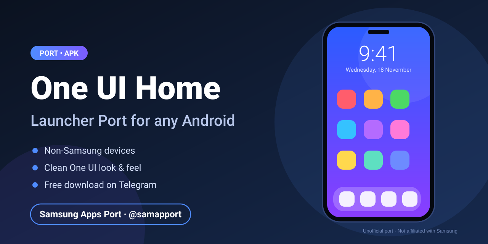

# One-ui-9-home-port
One ui 9 home port for all android devices 

# One UI Home Port

Samsung One UI Home launcher ported for non-Samsung Android devices.

| | |
|---|---|
| **Version** | 18.0.07.59 (One UI 9) |
| **Requires** | Android [version]+ |
| **Tested on** | [device name], [ROM / Android version] |
| **Size** | [XX MB] |

## Features
- One UI 9 home screen and app drawer
- [Feature 2]
- [Feature 3]

## Screenshots
<!-- Add 2-4 screenshots from your device -->

## Download
Get the APK from the Telegram channel:
**[Download One UI Home Port](https://t.me/samapport/[POST_ID])**

## Installation
1. Download the APK from Telegram.
2. Allow installation from unknown sources.
3. Install the APK.
4. Set One UI Home as the default launcher in Settings > Apps > Default apps > Home app.

## Known issues
- [Issue 1]
- [Issue 2]

## Updates
Follow the channel for new ports and updates: [@samapport](https://t.me/samapport)

---
*Unofficial port. This project is not affiliated with, authorized, or endorsed by Samsung Electronics. All trademarks belong to their respective owners.*
